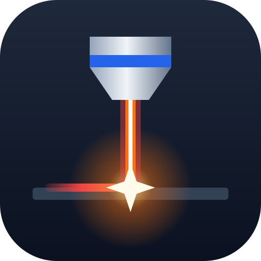
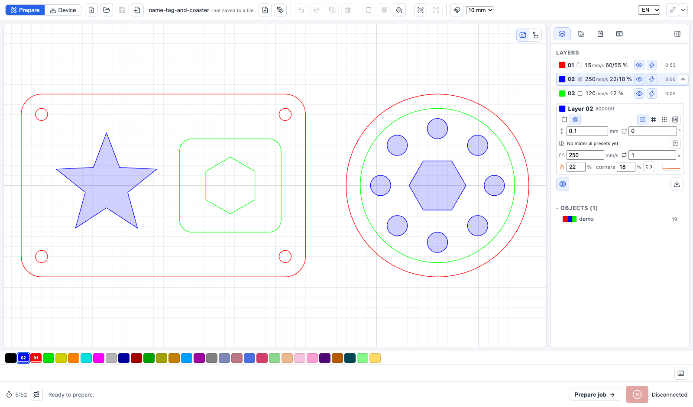
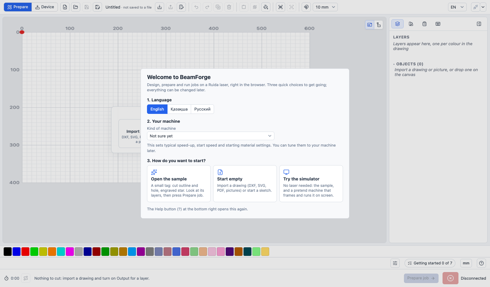
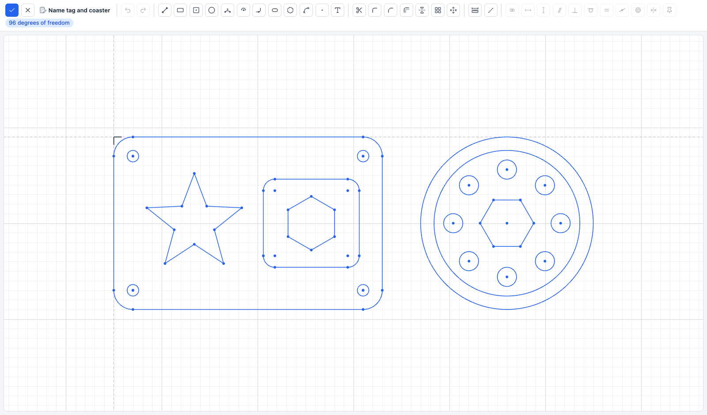
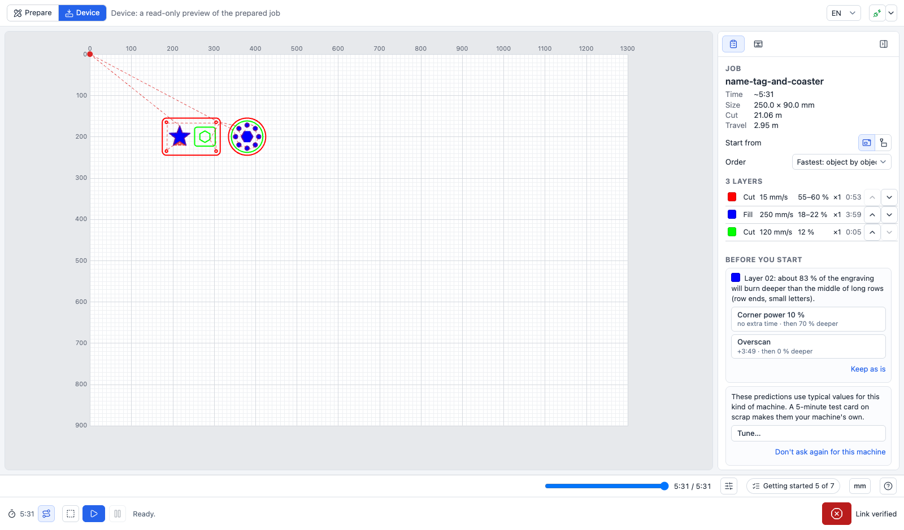
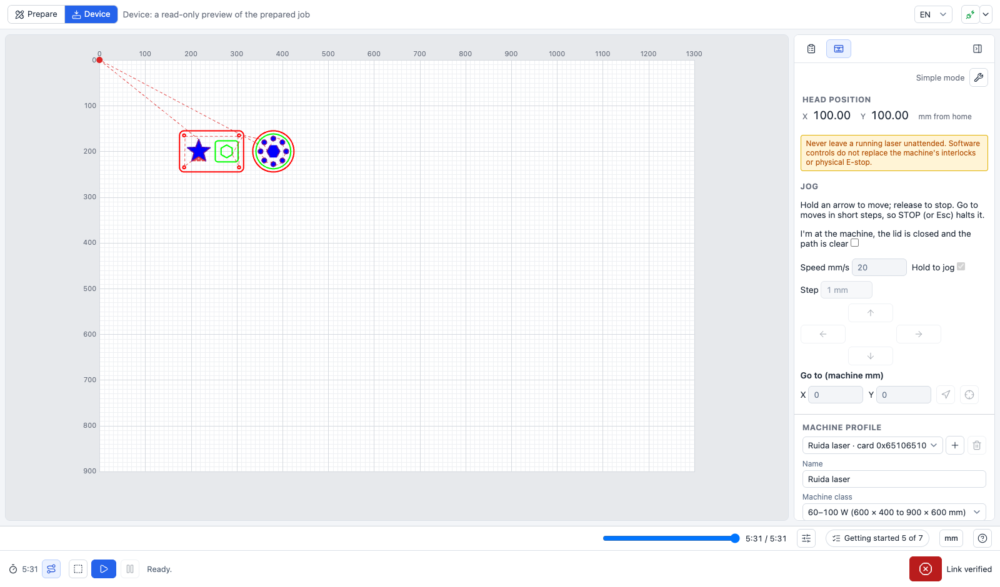
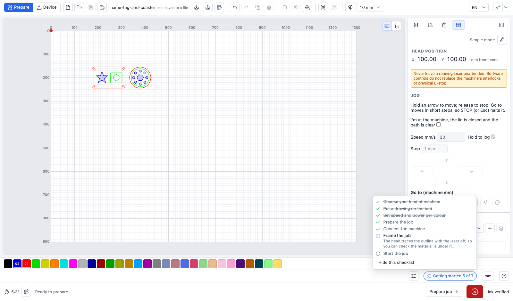
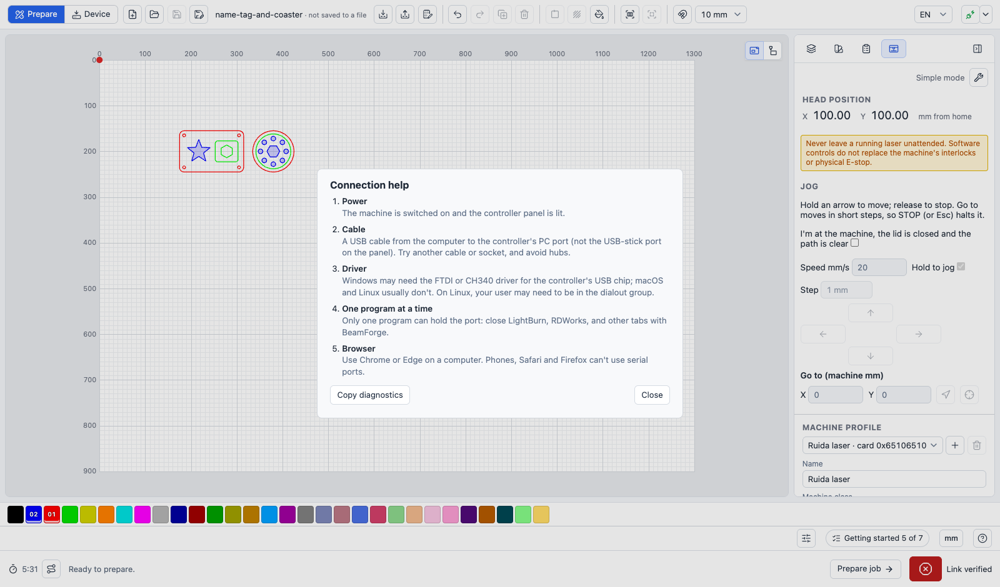

<p align="center"></p>

# BeamForge

**Draw. Prepare. Cut.** A browser-based workspace for Ruida laser controllers.

BeamForge is a LightBurn-style app that runs entirely in the browser. You draw or import a design, set up layers,
plan the job, and send it to the laser over USB. There is nothing to install and no server: the page talks to the
controller directly through the browser's Web Serial API.

**Try it:** [alikhan-yessaly.github.io/beamforge](https://alikhan-yessaly.github.io/beamforge/). The built-in
simulator works without a machine.

> **Beta:** BeamForge has been tested on one RDC644XS controller, not across
> all Ruida models. Sketch-generated cuts and fill have not yet been verified
> on physical hardware. Use only if you understand the risks and can supervise
> the machine throughout the job.



## Contents

- [What it does](#what-it-does)
- [Screenshots](#screenshots)
- [Features in detail](#features-in-detail)
- [Safety and limitations](#safety-and-limitations)
- [Get started](#get-started)
- [Project layout](#project-layout)
- [Feedback and contributions](#feedback-and-contributions)
- [License](#license)

## What it does

- **Design:** import DXF, SVG, PDF, Illustrator (AI), PLT/HPGL and CorelDRAW (preview) files, or create
  parametric sketches (dimensions, constraints, fillets, patterns, text). Imported DXF files can also be edited
  as sketches.
- **Pictures:** trace PNG, JPEG, iPhone HEIC, BMP, GIF, WebP and AVIF pictures into vector shapes. The app looks at
  the picture and picks the settings itself: colours or black and white, centre lines for line drawings, and a cut
  outline around stickers and logos. A few other versions are shown side by side to pick from.
- **Smooth outlines:** jagged imports (pixel stair-steps, zigzags, wobble) are smoothed into clean curves and long
  lines, so the laser doesn't stutter through hundreds of tiny moves. Sharp corners stay sharp.
- **Export:** the selection or the whole drawing as SVG, DXF, PDF, PNG or JPEG, with a preview.
- **Layers:** each colour is a layer that either cuts outlines or fills (engraves) areas, with its own speed,
  power and passes. The Fill tool engraves any closed area in a colour of its own.
- **Job planning:** fills always run before the cuts around them. Jobs run object by object, layer by layer, or
  whichever travels less. A toolpath preview and a time estimate show the result before anything runs.
- **Device mode:** a read-only view of the prepared job, with its time, size and cut order. From here you can
  frame, start, pause and stop the job, or save it in the controller's memory to start later from the machine's
  panel.
- **Machine tuning:** keep several machine profiles, matched to the connected controller automatically. Pick a
  machine class for typical values, then tune it with guided test cards (engraving evenness, scan offset, power and
  speed, kerf) that you read back by clicking a drawing of the card.
- **Even engraving:** before a job, the app predicts where engraving will burn deeper (row ends, small letters) and
  offers fixes with their time cost: overscan, sweeping areas together, or a lower corner power.
- **Machine control:** see the head position, jog, go to a point, and use a software Stop. The bed size is read
  from the controller.
- **Projects:** save and open `.laserproj` files (with the materials they use; dropping one on the app opens it), export Ruida `.rd` job files, keep a
  material library per machine, and save a machine's tuning as a `.beamtune` file.
- **First run:** a welcome screen (language, kind of machine, then a sample, an empty bed or the simulator), a
  "Getting started" checklist up to your first job, connection help, and a notice when a new version is out.
- **Languages and units:** English, Kazakh and Russian; positions and sizes in mm or inches.

## Screenshots

| | |
|---|---|
|  |  |
| **Welcome.** The first start asks for the language and the kind of machine, then opens the sample, an empty bed or the simulator. | **Sketch mode.** Any DXF opens as a sketch, named at the top. The toolbar has drawing, modify, dimension and constraint tools; it shows the remaining degrees of freedom. |
|  |  |
| **Device mode.** The planned job, with travel moves as dashed lines. The fills (blue) run before the cuts around them, one part at a time. The Job tab lists the time, size, cut and travel lengths and the layers, and suggests fixes for uneven engraving. | **Machine tab.** The head position, hold-to-jog pad, Go to and the machine profile. Here it is connected to the built-in simulator. |
|  |  |
| **Getting started.** A checklist from choosing the machine to the first job; steps tick off as you do them. | **Connection help.** Power, cable, driver, other programs holding the port and the browser, with a button that copies diagnostics for a bug report. |

The design in these screenshots is [`samples/demo.dxf`](samples/demo.dxf).

## Features in detail

### First run and help

- **Welcome screen** on the first start: pick the language and the kind of machine (it sets typical speed-up,
  start speed and starting materials), then open the sample, start with an empty bed, or try the simulator with no
  laser attached. Help → Welcome guide opens it again.
- **Getting started** checklist in the status bar: choose the machine, put a drawing on the bed, set speed and
  power per colour, prepare the job, connect, frame and start. Steps tick off by themselves; the list can be
  hidden.
- **Help menu** (? at the bottom right): the welcome guide, keyboard shortcuts, connection help, Copy diagnostics
  (version, browser, connection and recent controller traffic, for bug reports) and the safety notes.
- **Update notice:** when a new version is published, a notice offers to reload.
- **Units:** the mm / in button next to Help switches the display to inches (see below).

### Drawing and sketches

- An empty bed offers three ways in: import a drawing, start a sketch, or open the built-in sample tag.
- Rename an object by double-clicking its name in the Objects list, with F2, or with right-click → Rename. Double-click
  the project title to rename the project, or the sketch name in sketch mode. Unnamed sketches become "Sketch 1",
  "Sketch 2", and so on.
- The **mm / in** button in the status bar switches positions, sizes, rulers and snap steps to inches. Files, layer
  settings and the machine always use millimetres.
- Import DXF files, or drop them on the canvas. Supported entities: LINE, LWPOLYLINE (with arcs), POLYLINE, ARC,
  CIRCLE, ELLIPSE, SPLINE, INSERT/blocks and SOLID. Text, hatches and dimensions are skipped with a warning.
  Units come from `$INSUNITS`; drawings without units are read as millimetres.
- SVG/SVGZ, PDF, AI (saved with PDF compatibility) and PLT/HPGL open an import dialog. It lists each outline and
  fill colour in the file with the layer colour it maps to (the nearest palette colour); change, merge or skip
  any of them. Filled shapes can be engraved, cut along their outline, or ignored. You can also set the scale and,
  for PDFs, the page. Text and embedded pictures are skipped with a warning (convert text to outlines first).
- Outline smoothing (Off, Light 0.25 mm, Medium 0.5 mm, Strong 1 mm, Very strong 2 mm, or any size typed in
  from 0.05 to 10 mm, at the finished size)
  removes stair-steps, zigzags and wobble smaller than the level, keeps sharp corners (optional), merges runs of
  tiny lines and drops specks. When a file looks jagged it starts at a level about 2.5 times its stair-step size.
  The dialog shows the segment count before and after.
- CorelDRAW (`.cdr`) files are imported on a best-effort basis: the preview picture stored in the file is traced.
  For the real vectors, export SVG or PDF from CorelDRAW.
- Pictures open a tracing dialog with a live preview, already set up for the picture:
  - **Automatic:** the backdrop (plain light, plain dark, transparent or a busy photo), the real ink colours
    (anti-aliased edges don't count as colours), photo or flat artwork, and the stroke width decide the trace.
    Up to three other versions appear as thumbnails (outlines or centre lines, colours or black & white, with or
    without the cut outline, bolder or finer). The detailed controls sit under **Fine-tune**.
  - **Centre lines:** thin strokes become single open lines along their middle, one pass each, instead of two
    outlines around every stroke.
  - **Sticker style:** artwork on a plain backdrop gets a cut outline around the whole design (1.5 mm out by
    default, holes ignored), and the inside is engraved. It can be turned off or given another margin.
  - **Cut-out pictures:** a picture with a transparent background can be traced by its shape.
  - Black & white: threshold (or automatic), brightness, contrast, blur and invert.
  - Colours: 2 to 8 colours, each on its own layer; the white background can be left out.
  - Despeckle, corner smoothing, outline smoothing (Light by default), detail level, the width in millimetres, and
    whether traced shapes are engraved or cut. Small pictures are enlarged smoothly before tracing, for cleaner
    edges.
  - The picture can stay on the canvas as a reference. It is never sent to the machine.
- **Export** (⌘E or right-click → Export…) writes the selection or everything as SVG (one Inkscape layer per
  colour), DXF, PDF (one layer per colour), PNG or JPEG, with a preview of the result.
  - PDF pages: fit to the drawing, A5 to A1, Letter, Legal, Tabloid or the bed size. The drawing is centred at its
    real size; the smallest A size that fits is suggested, and a drawing larger than the page is flagged.
  - PNG and JPEG: resolution presets from 96 to 1000 DPI (254 DPI is 0.1 mm per pixel) or a custom pixels per mm.
    The dialog shows the pixel size, megapixels and mm per pixel, and the resolution is saved in the file. PNG
    can have a transparent background, JPEG has a quality setting, and pictures can be included.
  - SVG, DXF, PNG and JPEG can keep the position on the bed.
- **Sketch mode** is a small parametric CAD editor:
  - Drawing tools: line, rectangle, circle, arc, slot, polygon, spline, point and text.
  - Modify tools: trim, fillet, chamfer, offset, mirror, and linear, grid and circular patterns.
  - Constraints: dimensions, coincident, horizontal, vertical, parallel, perpendicular, tangent, equal, midpoint,
    concentric, symmetric and fix.
  - It snaps to points, curves and the grid, and infers horizontal and vertical alignment as you draw.
  - Geometry is coloured by state: blue can still move, black is fully defined, red conflicts. Size suggestions
    after each shape let you type a dimension straight away.
  - Construction geometry is never cut.
  - Text uses the bundled Roboto font or, in Chrome, your computer's fonts.
- On the canvas, move, scale, stretch, rotate, mirror, align, group and nudge objects. Undo, copy and paste work
  as usual. Press **?** for the shortcut sheet.

### Layers, fill and materials

- Each colour is a layer that **cuts** or **fills**. Each layer has its own speed, power, passes and corner power;
  the corner power is how the Ruida lowers power at slow corners.
- Fill patterns: lines, cross-hatch, dots and offset contours, with spacing and angle. Holes stay empty.
- The **Fill tool** engraves the inside of any closed shape in its own colour, so "engrave the face, then cut the
  part out" takes two colours with separate settings.
- A **material library** stores engrave, cut and score settings per material, for each machine profile. Typical
  settings for the machine's class (plywood, acrylic, cardboard, leather) can be added in one click, and cut
  presets can carry a kerf.
- **Overscan** (fill layers): the laser stays off while the head speeds up and slows down at each row end, so the
  edges burn as deep as the middle. Auto uses the machine's acceleration.
- **Sweep:** areas that share rows can be swept together (they burn alike) or each on its own; the default picks
  the quicker.
- **Kerf compensation** (cut layers): outlines grow and holes shrink by half the kerf, so parts come out at their
  drawn size. **Scan offset** lines up rows engraved in opposite directions.

### Job planning and preview

- Fills always run before the cuts around them, and inner shapes (holes) are cut before the outline around them,
  even across layers. This way a part never drops out before its inside is done.
- The **Order** setting has three choices:
  - **Object by object:** each part is engraved and cut before the next one, nearest first.
  - **Layer by layer:** all fills, then all cuts.
  - **Fastest** (the default): whichever of the two finishes sooner by the time estimate.
- The cut order is optimised for travel time, using the machine profile's travel speed and acceleration, so lots of
  small shapes (text) don't make the head zigzag:
  - A letter is cut together with its counters (the holes in o, a, e).
  - The tour is improved with 2-opt and Or-opt and doesn't cross itself. It ends near where the outline around it
    starts, and the outline ends near home.
  - A closed shape starts where arriving and leaving is quickest, preferring a sharp corner, where the head stops
    anyway and the seam is hidden.
- Fill paths are planned to avoid wasted travel:
  - Hatching sweeps each region back and forth, and the sweeps are ordered the same way as cuts.
  - Cross-hatch continues from where the first direction ended.
  - Offset contours run from the outside in.
- The **preview** draws the toolpath, including travel moves, with a time scrubber. The time estimate uses the
  machine profile's travel speed and acceleration.

### Machine profiles and tuning

- Keep several **machine profiles**. On connect the app picks the one that belongs to the controller (Card ID and
  bed size) and asks when that's unclear.
- A new profile asks its **machine class** (40–60 W desktop, 60–100 W, 100–150 W large bed, or other), which sets
  typical acceleration, start speed and lowest firing power. These are starting values, not measurements.
- **Tuning** (Machine tab) is a guided, skippable wizard with four test cards, each placed near the home corner on
  free colours:
  - **Fill evenness:** measures the acceleration and which fix evens out engraving depth.
  - **Scan offset:** the shift that lines up back-and-forth rows, per speed.
  - **Power and speed:** a grid whose chosen squares become the material's presets.
  - **Kerf:** holes and a peg; the snug hole gives the kerf.
- Before a job, **Before you start** in Device mode lists layers predicted to engrave unevenly, with each fix's
  time cost; one click applies it.
- **Advanced** mode (status bar) shows every raw value. A machine's tuning and materials save as a `.beamtune` file.

### Device mode and running jobs

- **Prepare job** plans the job and switches to **Device** mode: a read-only preview, the job summary, the order
  and the layer order (↑/↓ to change it).
- **Start from** places the job either at the drawing's position on the bed, or at the head's current position.
- **Frame** traces the job's outline with the laser off.
- **Start** first shows a checklist: the job time, any warnings and the safety reminders. **Pause/Resume** and
  the software **Stop** (Esc) control a running job, and a progress bar follows it.
- **Save to machine** stores the job in the controller's memory under a name, like LightBurn's Send, so it can
  be started later from the machine's panel. The stored files are listed, and you can delete them.
- **Save .rd** exports the job as a Ruida `.rd` file.

### Connection and safety checks

- Connections:
  - **USB:** Web Serial in Chrome or Edge.
  - **Simulator:** a simulated RDC644XS that runs jobs, moves and jogs in real time.
  - **Dev bridge:** a local WebSocket bridge for browsers without Web Serial, and for scripts.
- Nothing except a read-only Card ID query is sent until the controller's reply decodes correctly, which confirms
  the model setting.
- Jobs are checked against the controller's bed before they are sent.
- Memory-write commands are only available in an opt-in developer mode.
- Moves such as Go to are split into short segments, so Stop takes effect quickly.
- **Help → Connection help** (also offered when connecting fails) explains the likely cause and walks through power,
  cable, driver, other programs holding the port, and the browser. Browsers without Web Serial get a notice and can
  still use the simulator.

### Command line

The same safety-checked code drives a small CLI through the dev bridge or the simulator:

```sh
npm run bridge                                # in one terminal: share the USB port over ws://127.0.0.1:8765
npm run ruida -- status                       # card ID, status, position, bed size
npm run ruida -- goto 200 150 --speed 50      # absolute move, machine mm
npm run ruida -- frame-job job.rd             # trace a job's box, laser off
npm run ruida -- status --sim                 # any command against the simulator instead
npm run decode -- job.rd                      # print the commands in an .rd file
```

## Safety and limitations

**Never leave a laser running unattended.** Maintain the machine's interlocks,
ventilation and physical emergency stop. Software controls and the software
Stop are not substitutes for those safety devices.

Check the controller model, bed dimensions, origin, material and job placement
before operating. Frame the job and use conservative settings appropriate to
your machine and material. A result in the simulator does not prove a job is
safe or correct on hardware. Stop using the app if behavior is unexpected.
Before each job, review the safety reminders and confirm them with
**Confirm and start**; the app cannot verify those physical conditions.

The software Stop cannot interrupt a frame once it is running; use the
machine's own Stop or emergency stop.

Only one RDC644XS machine has been tested. Compatibility with other machines,
firmware and controllers is not established. Fill, sketch-generated cuts,
object-by-object job order, large jobs and recovery after connection problems
need further hardware validation. Overscan, scan offset, kerf compensation and
the tuning test cards have been checked in the simulator only, and the machine
class values are typical, not measured.

## Get started

Use desktop Chrome or Edge with Web Serial in an HTTPS or localhost context.
Connect the controller by USB and select the correct device in the browser's
port chooser. The app runs in the browser; project data and machine preferences
are stored locally in the browser unless you save a project file.

To run locally, install Node.js 22, then:

```sh
npm ci
npm run dev
```

Open the localhost URL printed by Vite (or the [beta site](https://alikhan-yessaly.github.io/beamforge/)). The
welcome screen asks for the language and the kind of machine; choose **Try the simulator** to explore without
hardware, then follow the **Getting started** checklist in the status bar: prepare the sample job, connect, frame
and start. Later, the connection menu next to the plug icon (top right) switches between USB and the simulator.

Run `npm test` and `npm run build` to validate changes.

## Project layout

```
src/protocol/    Ruida wire format: byte scrambling, numbers, commands, job encoder and decoder
src/controller/  Link (Card ID gate, queries), motion, job runner, stored files, frame
src/transport/   Web Serial, simulator, WebSocket bridge, traffic log
src/job/         Planning: layers, fill paths, cut order, time estimate, depth checks, kerf, doc → job
src/machine/     Machine classes, motion model, material presets, .beamtune files
src/tuning/      Test cards and reading their results
src/sketch/      Parametric sketch model, constraint solver (planegcs), modify tools, text
src/dxf/         DXF parser
src/import/      SVG, PDF, HPGL and CDR readers, picture decoding and tracing (Potrace port)
src/export/      SVG, DXF and PDF writers
src/workspace/   The Preact interface
scripts/         CLI, dev bridge, .rd decoder
tests/           Unit tests (Vitest), including byte-for-byte checks against LightBurn jobs
```

## Feedback and contributions

Please report bugs and hardware compatibility results in the repository's
issue tracker. Remove personal data and machine identifiers from logs before
sharing. Describe your controller model, browser, steps to reproduce, and
whether you used the simulator or real hardware. **Help → Copy diagnostics** copies the app version, browser,
connection state, machine settings and recent errors (not your drawing or machine name) to paste into a report.

Use a branch and open a pull request for proposed changes.

## License

BeamForge is distributed under the [MIT License](LICENSE), which permits
personal and commercial use. Third-party packages retain their own licenses.
